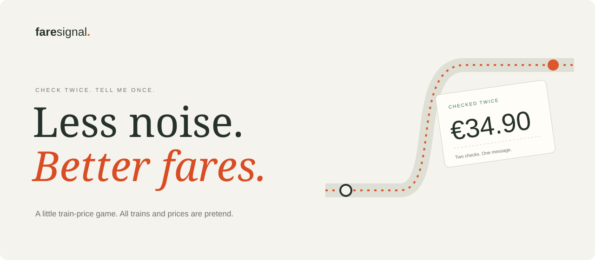
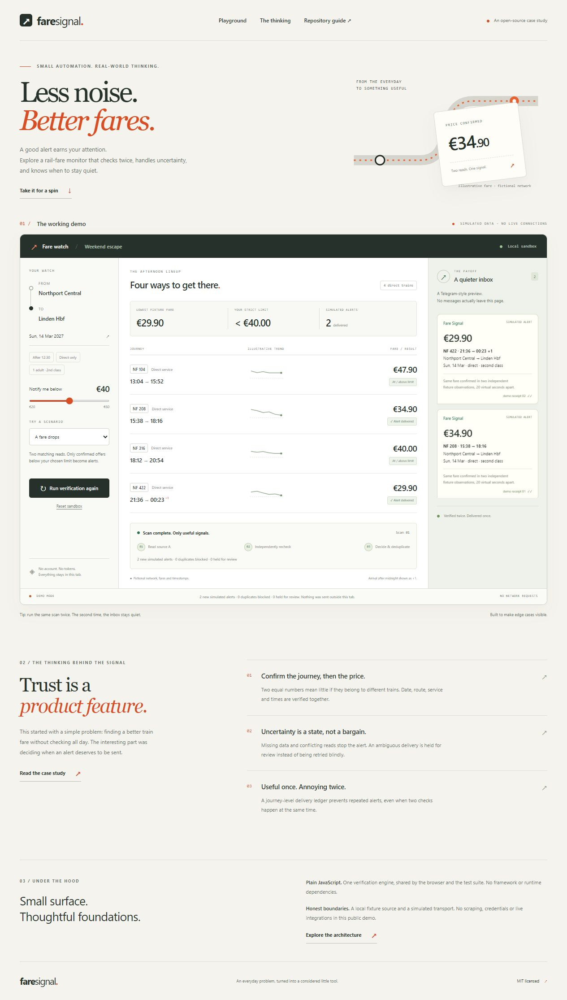

<p align="center"></p>

<p align="center"><strong>Check twice. Tell me once.</strong><br>A little train-price game that shows when to send a message.</p>

<p align="center"><a href="https://annamariadirella-coder.github.io/fare-signal/">Try it now</a> · <a href="#run-it-on-your-computer">Run it at home</a> · <a href="docs/CASE_STUDY.md">The story</a> · <a href="docs/ARCHITECTURE.md">How it works</a> · <a href="docs/PRESENTING.md">Show a friend</a></p>

<p align="center"><a href="https://github.com/annamariadirella-coder/fare-signal/actions/workflows/ci.yml"></a> · JavaScript · No extra packages · MIT</p>

## What is this?

Imagine you want a train ticket for **less than €40**. You do not want to keep looking at the price all day.

Fare Signal shows how a little helper could look for you. Before it tells you about a price, it asks:

1. Is this the right train?
2. Did we see the same price twice?
3. Is it below the amount you chose?
4. Have we already told you about this train?

Think of the last step as a notebook. Once the helper has told you, it puts a tick beside that train. It does not tell you again.

**This is a pretend example.** The stations, trains and prices are made up. The message box looks a bit like Telegram, but it sends nothing to Telegram. You cannot buy a ticket here. You need no account or secret key.



## Walk through the whole story

Open the [demo](https://annamariadirella-coder.github.io/fare-signal/). Leave the limit at **€40**.

1. Press **Make a pretend bot**. This acts out making a Telegram bot.
2. Press **Press Start — pretend chat**. The chat shows your pretend `/start` and the bot's hello.
3. Press **Start the pretend watch**. The helper is ready for its timer.
4. Press **Jump 2 hours & check**. The clock moves. Follow the six steps: wake up, find trains, check twice, check the notebook, send to Telegram, save the receipt. Two pretend messages appear.
5. Open **Open the notebook**. See both price reads, each decision and the “told you” marks.
6. Jump two hours again. No new messages appear: the helper remembers.
7. Try **The prices do not match** or **Did the message arrive?**. The helper waits when it is unsure.
8. Press **I bought a ticket — stop**. The watch stops. **Start over** lets you replay from the bot setup.

The clock, bot setup, prices, chat and receipts are all pretend. Nothing runs in the background after you close this page.

## Built from a real end-to-end project

The original private project had a real railway reader, a GitHub Actions timer, two price checks, a saved message notebook and Telegram alerts. We bought a suitable ticket and stopped it. This public version lets you see the whole journey safely, with made-up data.

Read [from search to a phone message](docs/JOURNEY.md) for a clear map of what was real in the private project and what is simulated here. The private railway reader and its keys are not published in this repo.

At a €40 limit, **€39.99 is low enough. €40.00 is not.** “Below” means less than, not equal to.

## Run it on your computer

The easiest way to play is the link above. To run your own copy, first install **Node.js 22 or newer**. Node is a tool that lets your computer run this project's JavaScript.

Open a **terminal**: a window where you type instructions for your computer. If you have Git, a tool for copying and saving code, type these lines one at a time:

```sh
git clone https://github.com/annamariadirella-coder/fare-signal.git
cd fare-signal
npm start
```

Then open **http://127.0.0.1:8765** in your browser. This address points to your own computer. Keep the terminal open while you play. Press **Ctrl+C** there when you want to stop.

**No Git?** On this GitHub page, choose **Code → Download ZIP**. Unzip the folder. Open a terminal inside the folder that contains `package.json`, then type `npm start`.

You do not need `npm install`. There are no extra packages to fetch. If port 8765 is busy, stop the other copy, or set `PORT` to another number in your terminal.

## Handy commands

Run these from the project folder:

| Type this | What it does |
|---|---|
| `npm start` | Opens a small local server so your browser can load the demo. |
| `npm test` | Checks 15 examples to see whether the rules behave as expected. |
| `npm run check` | Checks code spelling, local page files and a few known secret patterns. |
| `npm run build` | Puts the website files in a folder called `dist/`. |
| `npm run standalone` | Makes one HTML file you can open without Node or a server. |

The one-file version is called `fare-signal-demo.html`. Make it on a computer with Node, then copy it to a computer with a modern browser. It has the pictures, rules and pretend data inside. Its guide links point to the explanation on the page.

For the normal version, use `npm start`. Double-clicking `index.html` may stop the browser from loading its separate code files.

## Four things to try

| Choose this | What happens |
|---|---|
| A cheaper ticket | Two prices are below €40. Two pretend messages appear. |
| The prices do not match | The two checks give different answers. No message. |
| No price comes back | A missing answer is not a free ticket. No message. |
| Did the message arrive? | The pretend sender gives no clear answer. The helper pauses instead of sending twice. |

The bot must be made, started and connected before a check can run. Buying a ticket stops the pretend watch. Moving the price slider keeps the notebook. Choosing a new example, pressing **Start over**, or reloading the page empties it. Start over also resets the bot and clock; choosing a new example keeps their current state. The page saves nothing after you leave.

## Where things live

A **repository**, or **repo**, is just a project folder saved on GitHub.

| Folder or file | Think of it as… |
|---|---|
| `src/monitor.mjs` | The helper's rules and notebook. |
| `demo/fixtures.mjs` | The made-up trains and prices. |
| `demo/journey.mjs` | The pretend bot, clock and stop button. |
| `demo/app.mjs` | The part that connects buttons to the rules. |
| `demo/styles.css` | The page's clothes: colors, sizes and layout. |
| `tests/monitor.test.mjs` | Little questions that check the rules. |
| `scripts/` | Tools to start, check and pack the project. |
| `docs/` | More explanations, in small steps. |
| `.github/workflows/` | Instructions GitHub follows to check or publish the project. |

## Read more

- [The whole journey, including Telegram](docs/JOURNEY.md).
- [The story](docs/CASE_STUDY.md): why this little helper exists.
- [How it works](docs/ARCHITECTURE.md): the rules, with examples and exact details.
- [Show a friend](docs/PRESENTING.md): a short demo you can follow.
- [Put your copy online](docs/PUBLISHING.md): the publishing steps.
- [What we checked](docs/QA.md): what passed and what we have not proved.
- [Help improve it](CONTRIBUTING.md), [keep secrets safe](SECURITY.md), and [be kind](CODE_OF_CONDUCT.md).

## What this little example cannot do

It does not look up real fares or send real messages. Its notebook lives only in this open page. A real helper needs a notebook that survives restarts, real price checks, a clock, a timer and a safe way to send messages. [How it works](docs/ARCHITECTURE.md) explains these parts.

The automatic secret check looks for only a few patterns. A person still needs to review files before sharing them. Browser checks are not a promise that every browser or accessibility tool will work perfectly.

This project is not connected to a railway company or Telegram.

**You may use and change the code under the [MIT license](LICENSE).** The license has the exact legal terms.
