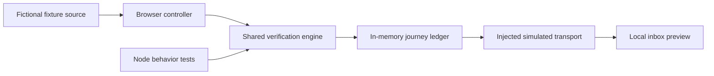
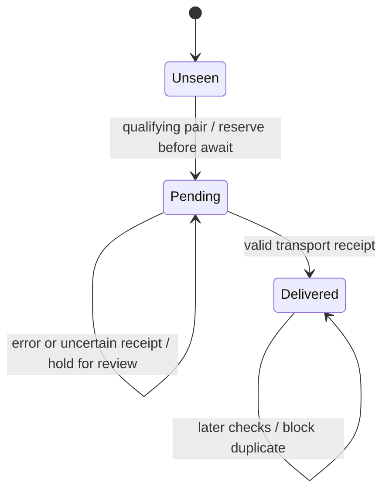

# Architecture and tradeoffs

## One engine, two consumers

`evaluate()` is a pure function. It accepts a journey, two observations and settings. It has no browser, clock, storage or network dependency. It validates eligibility and observation structure, then returns an explicit decision.

`Monitor.check()` handles delivery. A qualifying decision first consults the ledger, reserves an unseen identity, awaits an injected transport and records the receipt. A missing receipt or thrown error leaves the reservation pending.

## Contracts

Money is represented by positive safe integer `priceCents`. Thresholds are strict: price must be **less than** `thresholdCents`. Currency must be `EUR`.

A journey fingerprint contains `id`, `train`, `from`, `to`, `date`, `departure`, `arrival` and `direct`. Both observations must contain the same fingerprint. Dates in this demo are fixture strings, not a real operating calendar.

Observations use numeric millisecond timestamps. The pair must be at least 20 seconds and at most five minutes apart. This checks the pair's relative age, not freshness against the current time. The fixture controller advances a virtual clock; no claim of live observation is made.

The demo transport returns `{ id: 'simulated-N' }`. It never sends network traffic. Production transports must validate their real provider's receipt, and the application must decide how to reconcile ambiguous outcomes.

## Concurrency and durability

The synchronous reservation prevents two sends for one journey **within one engine instance in one JavaScript process**. It does not provide distributed locking or exactly-once delivery. The ledger clears on page reload, scenario change or manual reset.

A production ledger should reserve via a unique key or atomic transaction. Persist pending and delivered states, audit reconciliation actions, and document how an operator confirms delivery before retrying. Provider-side idempotency is preferable where available.

## Browser behavior

The controller disables controls while a scan animates. A scenario change resets the sandbox; changing the threshold preserves the ledger. Each scan uses deterministic fixture data and the same engine used by the Node tests.

There is no local storage, cookie, service worker, tracking pixel, external font, live API or third-party script. The HTML, CSS, modules and local assets are loaded normally by the browser.

## Test boundaries

The automated suite checks decision rules and delivery behavior. It does not prove live-source correctness, railway availability, distributed delivery guarantees or assistive-technology compatibility. Manual browser QA covers the primary desktop and mobile interactions; full accessibility certification is outside this repository's claim.
