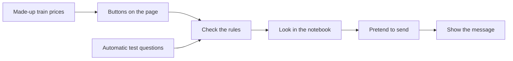

# How the little helper works

Imagine a helper with a notebook. It checks a train price twice. If everything looks right, it puts a message in a pretend inbox. Then it writes “told you” in its notebook.

## First, start the pretend bot

`demo/journey.mjs` keeps the story in order. Make a bot, press Start, then start the watch. Only then can the clock jump. Each click advances it by two hours and runs one check. There is no background timer. Buying a ticket stops it until you start over.

The six-step trail shows the timer, train search, second read, notebook, Telegram send and receipt. Open the notebook to inspect both made-up reads and each decision. The `/start`, hello and receipts are simulated; no Telegram request is made.

## Follow one ticket

The page and the tests use the **same rules**. This helps us check the code people actually use in the demo.

## First: is it the right train?

Two tickets can both cost €30 and still belong to different trains. The helper checks the train's name, stations, date, leaving time, arrival time and whether you need to change trains.

In the code, `fingerprint()` makes a label from those details. The label includes `id`, `train`, `from`, `to`, `date`, `departure`, `arrival` and `direct`. Both price checks must have the same label as the chosen train. The visible pretend clock explains the two-hour schedule; the price reads use a separate fixture clock to keep a 20-second gap. Neither is a real railway timestamp.

Only direct trains on the chosen route and day, leaving **after** the chosen time, can pass. A train at exactly 12:30 does not pass a rule saying “after 12:30.”

## Next: do the prices match?

The two checks must show the same price in euros. A missing price is not zero. If one check says €30 and the other says €35, the helper waits.

The code counts **cents**: €34.90 becomes `3490`. Whole cents make it easier to compare money without tiny rounding errors. `priceCents` must be a positive, safe whole number. The price must be less than `thresholdCents`, the chosen limit in cents. The currency must be `EUR`.

The checks must be 20 seconds to 5 minutes apart, including both ends. Their `at` values count milliseconds. In this game, the clock is pretend, so the page can show 20 seconds passing in a short animation. The dates are made-up example dates.

This checks the gap **between** the two reads. It does not check whether either read is fresh compared with the real clock. Two made-up reads also do not prove that two real websites agree.

`evaluate()` does this rule checking. It receives the train, two reads and settings, then returns an answer. It does not send messages or use the browser, network, clock or notebook itself.

## Last: have we already told you?

`Monitor.check()` uses the answer and looks in the notebook, called a **ledger** in the code.

| Notebook entry | What the helper does |
|---|---|
| Nothing yet | Writes “waiting,” then tries to send. |
| Waiting | Pauses. Someone must check what happened. |
| Told you | Keeps quiet. No second message for this train. |

It writes “waiting” **before** starting the send. Think of putting your name on a toy before walking away: a second check can see the mark and will not start another send.

The pretend sender returns a receipt such as `{ id: 'simulated-1' }`. Then the entry becomes “told you.” An error or missing receipt leaves it at “waiting.” A real message might have arrived even when the sender did not get an answer, so trying again at once could send it twice.

The notebook remembers the **train journey**, not its price. Even if that train gets cheaper later, it does not send another message.

## Where the notebook stops helping

This protection works inside **one copy of the engine in one JavaScript process**. Separate running copies do not share the notebook. It is not a promise that a real message will arrive exactly once.

Reloading the page, choosing another example or pressing **Start over** empties the notebook. Moving the budget slider keeps it. Buttons pause while a check is running.

A real service needs a saved notebook shared by all its running copies. Writing “waiting” must happen as one indivisible step, often called an **atomic transaction** or a **unique key**. It also needs a clear way for a person to check uncertain sends before retrying them. If the message company supports a key that blocks repeat sends, use that too.

## What the browser loads

It loads this project's page, styles, JavaScript and pictures. There are no outside fonts, tracking scripts or live price calls. It uses no cookies, local storage or service worker. The pretend sender makes no network calls.

## What a real helper would still need

- Real price readers, with checks that the data is correct and new enough.
- A real clock and a timer to run checks.
- Rules for time zones, departed trains and how often a source may be asked.
- A shared notebook that survives restarts.
- A real sender, safely stored keys and checked receipts.
- A way to notice problems and fix uncertain sends.

The tests check our small set of rules. They do not prove that real fares are right, that tickets are available, or that every accessibility tool works. See [what we checked](QA.md).
