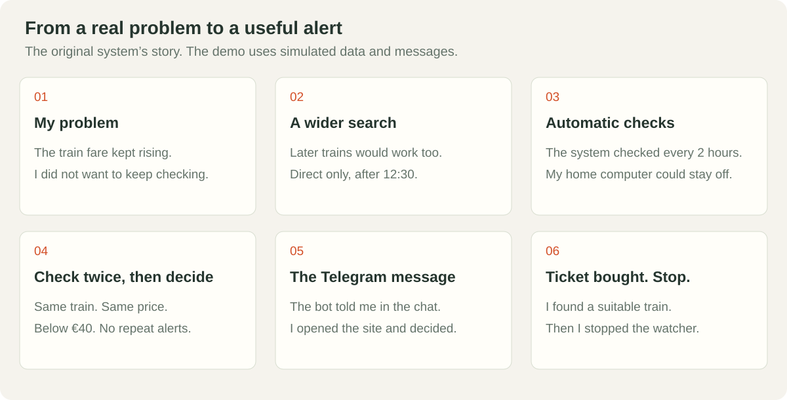
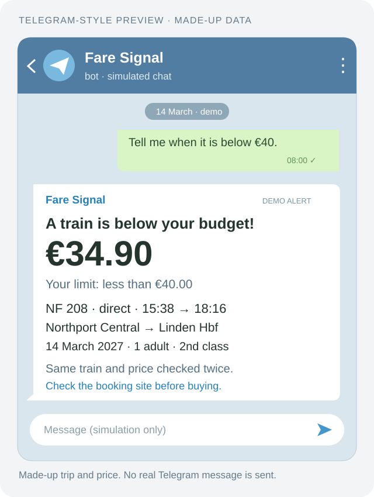

# The problem, the choices and the outcome

## 1. I did not want to check prices all day

I needed a ticket for a trip in Germany. The price of the train I was watching kept rising. My goal was simple: find a suitable departure below €40 without going back to the booking site again and again.

## 2. I widened the search, not the budget

A later train would work too. I asked the system to look for all direct departures after 12:30, on the same day and route. I no longer depended on the price of just one train.

## 3. I made the checks run automatically

The original system used GitHub Actions to run about every two hours. My home computer could stay off. It searched the departures, checked the filters and made sure it had read the right journey and fare.

A scheduled run can start late. The watcher helped with the search; it did not promise to find every offer.

## 4. I decided when a message was worth sending

A low price alone was not enough. It had to belong to the right train, appear in two matching reads and be strictly below €40. A missing or unclear answer never became an invented price.

The notebook remembered trains already sent. The same train should not produce the same message on every check. If delivery was unclear, the system did not blindly send again.

## 5. Telegram completed the path

The useful result reached the bot's chat. I did not have to watch another dashboard. I read the alert, opened the booking site and decided whether to buy. The bot's keys stayed in GitHub Secrets, outside the code.

This picture is a made-up example, not a copy of the private chat or the price we paid:

## 6. We bought a ticket and stopped the watcher

We found a suitable later departure and bought the ticket. Then we stopped the alerts. The watcher did not buy tickets or make decisions for us.

That is the outcome I can share. This project does not publish a paid fare, a saving or an unverified success rate.

## 7. I made a public version to show the work

The demo tells the story with made-up data: create the pretend bot, press Start, move the clock, watch the checks, receive the simulated message and stop after the pretend purchase.

The price and repeat-message rules are runnable code, also used by the tests. The railway search, timer and Telegram are simulated in the page. The private reader, secrets and history are not published. [See the full comparison](JOURNEY.md).

There are 16 automatic tests. They cover the exact budget boundary, wrong trains, different reads, checks running together, unclear delivery, bot setup, stopping and the portable presentation file. [The check record](QA.md) explains their limits.

**The value is the whole path: start with a need, remove repeated manual work and send a message only when there is something to act on.**
