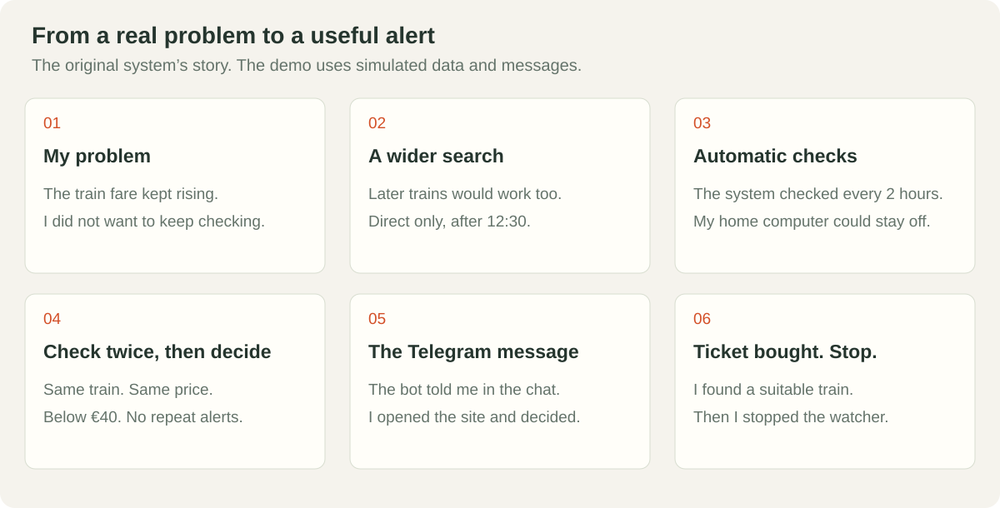
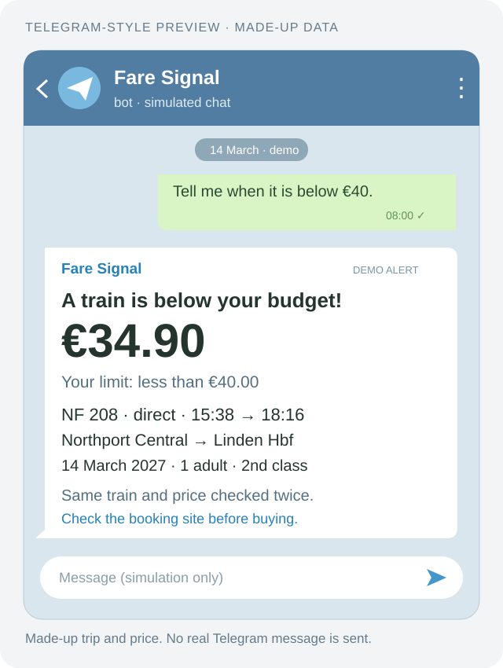

# From a rising fare to a message on my phone

I wanted a ticket below €40, but the fare for the train I was watching kept rising. Checking the site repeatedly took attention. I widened the search to later direct trains after 12:30, on the same day and route.

## The original system's path

1. **Choose the trip and budget.** The program knows which departures can work.
2. **A timer starts a check.** GitHub Actions ran it about every two hours. My home computer could stay off. Scheduled runs can start late.
3. **The reader finds trains and prices.** It checks route, date, times, directness and fare details. If it cannot confirm them, it does not invent a price.
4. **A second read checks the result.** It must be the same train at the same price.
5. **Check the budget and notebook.** The price must be less than €40. A train already sent does not get another alert.
6. **Telegram reaches me.** The bot sends the journey and price to my chat. I can open the booking site and decide whether to buy. The bot's key stays outside the code.
7. **Buy the ticket and stop the watcher.** That is what we did after finding a suitable later departure. The program bought nothing.

## What the result looks like

This drawing uses made-up data. It does not show the private chat, the paid fare or a claimed saving.

## What you can try in the public repository

| Part | Public demo | Original private system |
|---|---|---|
| Journey | Made-up trip, adjustable budget | Configured trip |
| Timer | A button jumps two pretend hours | GitHub Actions, now off |
| Prices | Two made-up reads | Real railway-site visits |
| Rules and notebook | Code shared with tests; memory in this page | Double checks and saved notification state |
| Telegram | Simulated bot, Start, chat and receipts | Real bot and alerts, now stopped |
| Purchase and stop | A pretend button stops the demo | We bought a ticket, then disabled the watcher |

The public code does not include the private railway reader. You can install and present the complete demo. On its own, it cannot search live prices or send phone messages.

## A clear way to describe it

“I built a train-price watcher with scheduled checks, a double price check, repeat-message protection and Telegram alerts. We used it to find a ticket and then stopped it. This public version lets you try the whole path with simulated data and messages.”

Keys, chat numbers, tickets and private messages stay out of this project.
